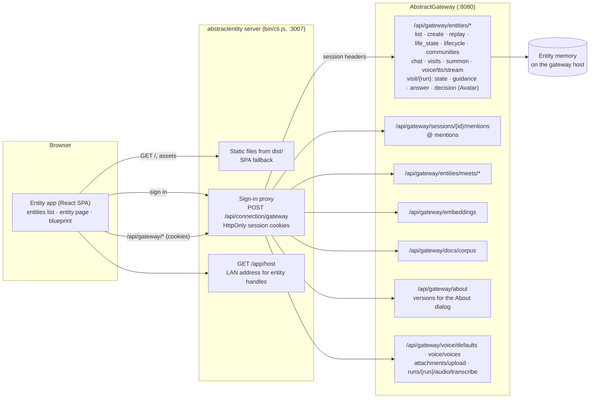
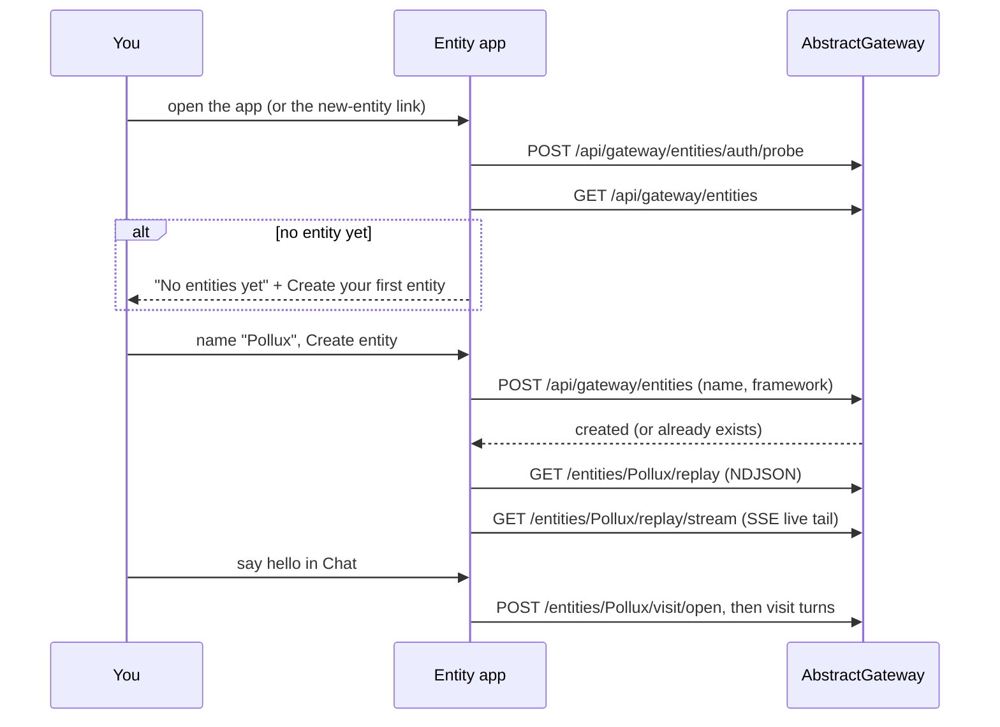
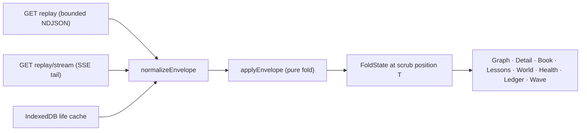
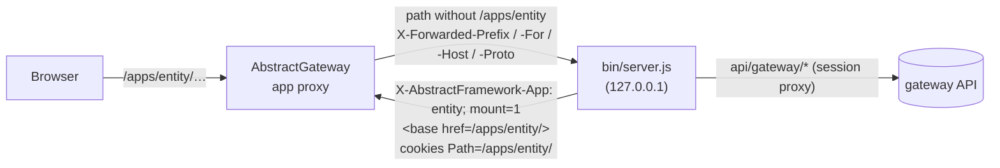

# Architecture

AbstractEntity is a static React single-page app plus a small Node server
(`bin/cli.js`). The server hosts the built app and the shared AbstractFramework
sign-in proxy (`@abstractframework/app-server`, `appId: "abstractentity"`). The
app keeps no server state of its own: everything it shows comes from
AbstractGateway's entity routes and from the memory engine's replay stream.

Read [Getting started](getting-started.md) first if you have not run the app yet.
The full list of routes and settings is in [API and configuration](api.md); how
data moves through each surface is in [Data flow](DataFlow.md).

## Components and connections



The browser talks only to the `abstractentity` server; the proxy swaps the
session cookies for gateway credentials. With `@abstractframework/app-server`
0.1.10 or newer, every request the proxy sends to the gateway also carries the
browser's own address (`X-Forwarded-For`, set from the connection and never
taken from the browser) and the marker
`X-AbstractFramework-App-Proxy: abstractentity`; see
[SECURITY.md](../SECURITY.md#session-model). A `?gateway=` link to a gateway on
another origin uses a direct posture instead: the app keeps the verified token
in memory for the tab and calls the gateway directly.

## Entity routes used by the app



All entity paths above sit under `/api/gateway`. The per-entity routes the app
reads or writes are listed in [API and configuration](api.md#gateway-routes-the-app-uses).

## The replay-stream fold

The memory engine writes an append-only replay stream of envelopes (form,
recall, commit, appraise, diary, valence, maintenance, plus gateway host
markers). The app folds this stream into its picture of a life:



The state at any position is the fold of every envelope up to it, so replay,
live tail and time scrub are one code path, and every tab agrees at any
position.

## Where a memory comes from

Every memory an entity forms is tied to the ledger that recorded the moment
(AbstractMemory ADR 0003, 2026-10-27): the run and ledger row `(run_id, seq)` of
the step that formed it, the verbatim artifact it was digested from, the
hash-chained diary entry it projects, or the memories it was derived from, whose
own sources reach the ledger. AbstractMemory keeps the references and the
revision history ("reconsidered on, superseded by"); AbstractRuntime's memory
facade rebuilds the verbatim from them, or answers `source_gone` when a run or
artifact has been deleted; the gateway serves both under `/api/gateway/memory/`.
The app only reads: see the proposed item
[Every memory names its ledger sources](backlog/proposed/2026-10-27_memory_sources_from_the_ledger.md).

## Scope of this repository

This repository ships the Entity app. The services that make entities live
(entity homes, visit workflows, lifecycle phases, sleep and dreams, skills) run
in AbstractGateway, AbstractRuntime and AbstractMemory, and the app uses them
over HTTP. This repository also holds two shared specifications those services
read: the lifecycle phase graph ([`spec/entity_phases.json`](../spec/entity_phases.json),
explained in [The entity life cycle](entity-phases.md)) and the cognition map
behind the blueprint page ([`spec/cognition_graph.json`](../spec/cognition_graph.json)).

## App modules (`src/`)

| Area | Modules |
| --- | --- |
| Entry and shell | `main.tsx`, `entity_view.tsx`, `error_boundary.tsx`, `brand_mark.tsx`, `entity.css` (layout, including the responsive rules; see [Responsive layout](../README.md#responsive-layout)), `drawer.tsx` + `side_tabs_state.ts` (the side panel: docked at 1024 px and wider, a drawer below), `entity_assistant.ts` (top-bar assistant over the gateway docs corpus; the drawer is AbstractUIC's shared Docs assistant, vendored in `vendor/abstractdocs/` by `npm run sync:docs`), `app_about.ts` (About dialog: app version and gateway versions) |
| Entities list | `entities_index.tsx` (each entity is the ui-kit `EntityCard` over its tile, with Watch, Retry beside the served reason and Resume from the served life state and loop, and the phase bar at the bottom; `roster_cards.css`), `roster_tiles.ts` + `card_reads.ts` (cards from the roster at once; live reads per card; tiles three at a time after them, kept 5 minutes or until the state or the served phase changes), `roster_empty.ts` (empty state and `#new` deep link), `create_entity_form.tsx`, `fleet_view.tsx` (watch all), `entity_state.ts`, `index_page.ts` (`?page=blueprint` mapping) |
| Stream | `stream_types.ts`, `stream_source.ts` (gateway client, NDJSON/SSE), `stream_fold.ts` (pure fold), `replay_cache.ts` (IndexedDB life cache), `temporal_activation.ts` |
| Graph | `graph_canvas.tsx`, `graph_lenses.ts`, `force_layout.ts` (the plain layout, before topics are served), `communities.ts` (reads his topics, payload version 2), `communities_source.ts` (fetches them), `topic_map.tsx` (the live `communities_changed` marker and `placed` events), `topic_layout.ts` (topics as the layout: circles, seats, drags), `topic_labels.ts` (titles on the canvas), `topics_panel.tsx` (the Topics panel and each topic's facts), `overlay_stack.ts` (on a phone-width graph, the Context legend and the Topics panel in one column, never over each other), `recall_emphasis.ts` (the recall highlight and the travelled paths), `replay_clock.ts` (playback pacing), `hover_card.ts`, `node_label.ts` |
| Life cycle | `phase_bar_source.ts` (the gateway seam: `life_state`, the `personal` toggle, `lifecycle`, sleep now), `phase_bar.ts` (what the bar shows for one answer, pure), `phase_bar_writes.ts` (writes in flight; Stop never waits), `phase_bar_controls.tsx` (the pills, Stop/Resume, Retry and the inline questions, on the entity page and the roster tiles), `mind_cognition_profile.tsx` (Settings → Mind, including the Sleep card) |
| Panels | `inspector.tsx`, `identity_card.tsx`, `timeline.tsx`, `ledger_panel.tsx`, `ledger_lines.ts`, `turn_detail_modal.tsx`, `verbatim_modal.tsx`, `phase_time.ts` |
| Reading surfaces | `book_reader.tsx`, `book_reader_select.ts`, `health_panel.tsx`, `health_metrics.ts`, `lessons_world_panels.tsx`, `cognitive_monitor.tsx` |
| Cognition wave | `utterance_harvest.ts`, `text_cache.ts`, `cognition_adapter.ts`, `cognition_wave_panel.tsx`, `cognition_wave_inline.tsx`, `vendor/cognition/` (scorer and basis vendored from AbstractUIC) |
| Visits (chat) | `chat_drawer.tsx`, `chat_message_list.tsx`, `turn_notices.ts` (the badges of what a reply formed, read from the served notices), `visit_mentions.ts` (`@` mentions: the list, one call per mention in order, resend of the unanswered ones), `use_flow_conversation.ts`, `flow_lane.ts`, `visit_status_poll.ts`, `live_activity.ts` + `use_live_activity.ts` + `turn_pulse_bars.tsx` (the live activity panel: what he does during a turn, row by row, from his visit's ledger or the flow brain's run view, then the turn folded into one line), `tool_claim_guard.ts`, `tool_descriptor.ts`, `workspace_panel.tsx` (Settings), `mind_voice_settings.tsx` (Settings → mind: the kit's shared picker), `identity_settings.tsx` (Settings → identity: the kit's `IdentityPanel` wired to the gateway: design, colour, voice with a sample, history; framework ADR 0052), `track_record_panel.tsx` (Settings → track record), `identity_avatar.tsx` + `use_identity_look.ts` (the entity drawn by its identity, in Settings and in the Avatar view), `entity_voice.tsx` (speak and dictate in a visit: the kit's `useGatewayVoice` on the gateway voice routes; Settings → voice listener half = the kit's `AfVoiceSection`) |
| Optional Avatar conversation | `avatar_visit.ts` (explicit public projection and privacy boundary), `use_avatar_visit.ts` (public visit state), `avatar_visit_view.tsx` (avatar, questions and permissions), `vendor/abstractchat/` (canonical AbstractUIC presenter). Shares the chat's composer and execution paths; does not read private life envelopes for public text. |
| Meets | `meet_console.tsx`, `meet_reader.tsx`; in a visit, an entity picked as an `@` chip offers a meet (`visit_mentions.ts` `meetOffers`; nothing is read out of the typed words) |
| Blueprint | `blueprint_panel.tsx`, `blueprint_tunables.tsx`, `phase_map.tsx`, `phase_editor.tsx`, `edge_ops.ts`, `spec_sync.ts` |
| Sign-in | `connect_gateway_modal.tsx`, `gateway_session.ts` |

## Invariants

The test suite pins these:

- **State at T is a pure fold.** Replay, live tail and scrub share one code
  path; rendering only reads the fold.
- **Two id namespaces.** Bindings use graph ids, usage events use row ids; the
  fold joins them only on `display.graph_id`.
- **Diary redaction is never reconstructed.** The engine's
  `{"redacted":"diary"}` display block is the only source; a sealed entry's
  words never enter any view or feed.
- **Tool claims come from data, never prose.** Tool use renders from
  `tools_used` attributes and host events only.
- **Spatial memory is durable.** Graph layout anchors are persisted per entity,
  never derived from the camera.
- **Kind vocabulary stays in sync.** `ENGINE_RECORD_KINDS` mirrors
  `abstractmemory.MEMORY_RECORD_KINDS`; a drift test fails when a kind would
  render as unknown.
- **A malformed stream line never breaks the app.** `normalizeEnvelope` guards
  every ingest boundary and each envelope is folded under its own guard.
- **Embedding spaces are never crossed silently.** The cognition wave scores
  only with the entity's own embedder; a mismatch is refused with a message.
- **A refusal is a sentence, never a JSON body.** Every gateway refusal shows
  its `detail` (`refusalDetail`), never the raw `{"detail": …}` text. A gateway
  with no embedding route (503 on `POST /embeddings`) gives the Cognitive
  Monitor one line — "Embeddings are not configured on this gateway, so the
  cognitive monitor cannot run." — and a **Set up embeddings** link to the
  gateway console's Multimodal page (`/console#defaults`, on the proxied
  gateway when the app runs behind its proxy).

## Serving

```text
abstractentity (bin/cli.js → bin/server.js, :3007; /apps/entity/ through the gateway)
  ├─ /                      the Entity app (SPA fallback for unknown paths)
  ├─ /entity.html           302 → ./  (older bookmarks)
  ├─ /app/host              {"lan_ip": ...} for entity handles
  ├─ /api/connection/*      sign-in (HttpOnly session cookies)
  └─ /api/*                 proxied to the gateway with session headers
```

`npm run dev` mounts the same sign-in proxy in the Vite dev server, so sign-in
behaves the same in development and production.

The server follows the `@abstractframework/app-server` mount contract, so the
same build serves at `/` on its own port and behind the gateway's
`/apps/entity/`:



The page gets `<base href>` and `base_path` from the server; the build uses
relative asset URLs (Vite `base: "./"`); every same-origin request is relative
(`api/gateway/…` through the ui-kit `joinBaseUrl`, `api/connection/gateway`,
`app/host`, `demo/…`); and `npm run build` fails on any root-absolute
same-origin URL in `dist/` (`scripts/check_relative_urls.mjs`).
