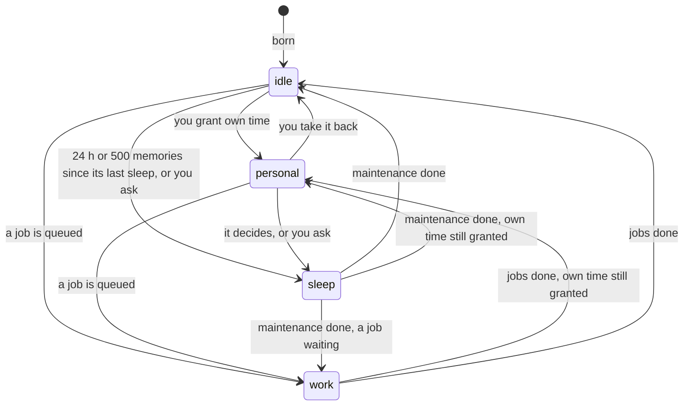
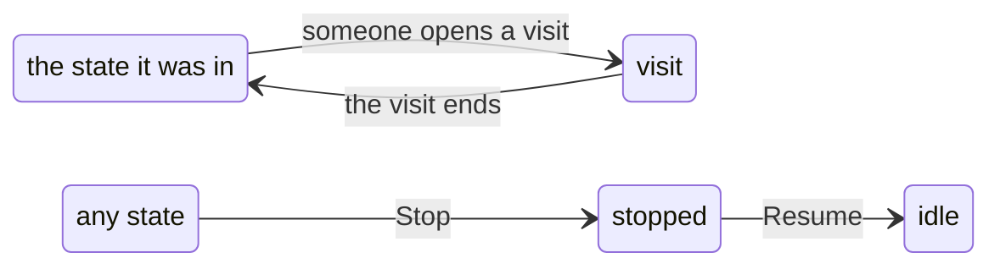

# The entity life cycle

An entity is always in one of five states: **idle**, **personal** (its own
time), **work**, **visit** or **sleep**. You can also **stop** it, which halts
everything until you resume it. The bar at the top of an entity's page, the
phase bar, shows where it is now, what comes next and what you may do.

This page explains the states, what moves an entity from one to another, and
how to read the bar. In it, *you* are the entity's guardian: the person who
looks after it. Granting own time, Stop, Resume and Retry need an admin
account; with another account the bar answers "Only an admin can grant his own
time, stop or resume him." The app speaks of an entity as "he" in its
sentences; this page quotes them as they appear.

## The five states

| State | What the entity does | How it gets there | When it ends |
| --- | --- | --- | --- |
| **idle** | Awake and reachable, with nothing to do. A new entity starts here. | It is born; you resume it; a visit, its jobs or a sleep end with nothing to return to; you take its own time back. | You grant own time, a job is queued, someone visits, or it goes to sleep. |
| **personal** (own time) | Explores its own ideas, questions and interests. It may decide to sleep for maintenance and wakes by itself when the maintenance is done. | Only you grant it, with the **personal** toggle. | You take it back, or something interrupts it (a job, a visit, a sleep). |
| **work** | Works on the jobs queued for it, one after another. | A job is queued: a request from an agent, a task left with it, or its standing work order. | All its jobs are done: back to its own time if you still grant it, else idle. |
| **visit** | Talks with the person who opened the visit, and waits between turns. | Someone opens a visit, in any state except stopped. | The visit ends: back to where it was. |
| **sleep** | Maintenance: it consolidates and enriches its memory. | It decides to during its own time, it is idle and a sleep threshold is reached (see [Sleep is maintenance](#sleep-is-maintenance)), or you put it to sleep. | Its maintenance is done: back to where it was. |

When you talk with an entity yourself, that is a visit, not work.

A visit and a stop sit across every state:

## Own time is yours to give

- Only you grant or take back an entity's own time, with the **personal**
  toggle (pressed means granted). The entity never gives itself own time, and
  it never starts its own time on its own from idle.
- While you grant it, the entity explores freely, sleeps when it needs
  maintenance and wakes by itself.
- A job, a visit or a sleep interrupts its own time. When the interruption
  ends, it goes back to its own time as long as you still grant it. If you
  turned own time off in the meantime, it stays awake and idle; the bar says
  "Own time is off; he stays awake."
- Turning **personal** off never puts the entity to sleep: it finishes the
  step it is on and stays awake and visitable.
- Stop cancels its own time. After Resume it is idle until you grant own time
  again.

## Work comes from its job queue

There is no work switch. Work starts when a job is queued for the entity, from
idle or from its own time (its own time is paused while it works, then
resumes). When all its jobs are done, it goes back to its own time if you
still grant it, else it stays idle.

The **work** pill lights while the entity works and has nothing to click. Its
tooltip names the current job and since when ("Current job: summon, since
18:20.") and how many are waiting ("2 jobs queued."). The line beside the
pills shows the same count ("2 jobs queued"). When nothing runs, the tooltip
reads "Not working now. Work starts when a job is queued for him".

## Visits come back to where it was

- A visit opens in every state except stopped. Click **visit** to open the
  conversation.
- When the entity is in the middle of a step of its own or of its maintenance,
  the visit waits for it to finish that step: "waiting" shows beside
  **visit**, and the sentence reads "In a visit with Laurent; he is finishing
  what he was doing." There is no time limit, and a visit never fails because
  the entity is busy.
- A visit interrupts a sleep; it does not end it. When the visit ends, the
  same sleep continues.
- When the visit ends, the entity goes back to where it was: its own time
  (while you still grant it), its work (while jobs remain), the same sleep, or
  idle.
- While the entity is stopped, the **visit** pill offers **Resume and visit**
  after a question: "Castor is stopped. Resume him and visit? He comes back
  idle, then the conversation opens."

## Sleep is maintenance

Sleep is never "nothing": while it sleeps, the entity consolidates and
enriches its memory, and it wakes when that maintenance is done. It goes to
sleep in three ways:

- **Its own decision** during its own time, when it needs maintenance.
- **On its own while idle**, once any threshold in **Settings → Mind →
  Sleep** is reached:
  - **Sleep after (hours without sleep)**: 24 by default, from 1 to 720;
  - **Sleep after (new memories)**: 500 by default, at least 1;
  - **Sleep after (share of memories not yet settled)**: 15 % by default,
    above 0 and at most 100 %. A memory is not yet settled while it is
    placed only provisionally, has no embedding, or still waits for its
    title or summary. This one fires only once something new formed since
    the last sleep.

  The thresholds count from its last completed sleep, apply only while it is
  idle, and are checked every few minutes. The line beside the pills then
  says why it sleeps: "asleep: 24 h since the last sleep", "asleep: 500 new
  memories since the last sleep" or "asleep: 18 % of his memories are not yet
  in a topic", as the gateway words it. After such a sleep it is idle again; it
  never goes to own time that the sleep did not interrupt. Each field saves
  when you press Enter or leave it, and shows "Saved" or the reason it was
  refused. A gateway that does not offer these settings yet says "This
  gateway does not offer the sleep settings yet." and the fields stay
  disabled; one that offers the first two but not the share says "This
  gateway does not offer this sleep setting yet." under the share's field,
  which stays disabled.
- **When you ask**: click **sleep**, then answer "Put Castor to sleep now?
  He wakes by himself when his maintenance is done." with **Sleep now**. The
  bar refuses it during a visit ("He is in a visit; end it to let him
  sleep."), while the entity is already asleep ("He is already resting; a
  sleep cannot follow a sleep.") and while it is stopped.

A sleep never follows a sleep directly.

## Stop and Resume

The red **Stop** button beside the pills is the kill switch. It asks first:
"Stop Castor? Stop halts everything now and cancels his own time; after Resume
he is idle until you grant own time again." **Stop now** confirms; **Cancel**
keeps everything as it is.

- Stop halts everything at once: its own time, any work and any conversation
  in progress. Nothing new starts, and requests sent to it are turned away
  until you resume it.
- Stop is always available, even while another change you made is still on
  its way.
- After a stop the bar shows what it did, for example "Own time was
  revoked.", and the line beside the pills says it in red, for example
  "Stopped. Nothing runs until you resume him."; nothing else on the page
  moves.
  When part of the stop could not finish, the bar names it and keeps a second
  **Stop** beside **Resume** so you can try again; the entity stays stopped
  either way.
- While stopped, the **personal** toggle and **sleep** are greyed ("Stopped.
  Resume him first, then choose what he may do."), and a visit is offered
  only through **Resume and visit**.
- **Resume** brings the entity back idle, awake and visitable. Its own time
  starts again only when you grant it. A job waiting for it then moves it to
  work.

A stopped entity is not asleep: it does no maintenance and forms no memories
until you resume it.

## Every interaction forms a memory

Each turn of a visit, and each exchange during its own time or its work, forms
at least one memory, even a very short one. A visit opened and closed without a
message forms none. Sleep is when the entity consolidates what it has formed.

## Reading the phase bar

- **Five pills**: `idle`, `visit`, `work`, `personal`, `sleep`, one per state.
  The current state is lit in gold. Stopped lights no pill.
- **personal** is the one toggle. Pressed (a filled ring) means own time is
  granted. It can be pressed while another pill is lit: with **work** lit and
  **personal** pressed, its own time resumes after the jobs.
- **idle** and **work** are indicators, with nothing to click; hover idle for
  the gateway's sentence. **visit** opens the conversation; **sleep** offers
  "sleep now" and lights while the entity sleeps.
- **Stop** or **Resume**, apart from the pills.
- **Retry** appears when its own time is granted but not running, with the
  reason: "His own time stopped unexpectedly. Retry to start it again." or
  "His own time is not running. Retry to start it."
- **The line beside the pills** reads, in order: one sentence for now, since
  when in your local time (with the date when it is not today), why it sleeps,
  how many jobs are queued, and where it goes next. For example: "Working on a
  request from an agent. · since 17:09 · 2 jobs queued · then: own time". The
  last part reads "then: own time", "then: work" or "then: idle". Hover the
  line for the exact time and what happens next in words ("When his jobs are
  done, his own time resumes.").
- **Tooltips** say what each pill does, or why it cannot act now.
- **Refusals** appear in the bar as sentences.
- **The status line** between the bar and the **Files** and **Settings**
  buttons holds the page's other sentences (for example "his own time stopped
  after repeated tick failures — restart when ready", a phase-rule note or a
  sign-in note): one line, ended with "…" when it is too long, the whole
  sentence on hover. A sentence appearing or going never moves the buttons or
  the graph.

The bar follows changes as they happen and reads the entity again every 15
seconds. The tiles on the entities list show the same pills and sentence;
Stop and Resume are on the entity's own page only. A gateway that does not
serve the five-state life cycle gets one sentence, "This gateway does not
serve the phase bar yet.", and the controls stay off.

### On a phone

Below 480 px (checked at 400 px), the phase bar takes the full width of the
screen: the five state words without their icons, then **Stop**, then the
sentence and any question on lines of their own. Nothing is cut off and the
page never scrolls sideways; swipe the controls row to reach **Settings**.

## Known limits

- **Stop and work already under way.** A Stop that lands while the entity is
  in the middle of a model call can let that one call finish before
  everything halts; a maintenance step already running may finish, and a
  mention's answer already being written is not cancelled. Nothing new starts
  after the Stop. Closing this gap is planned.
- **A mention's visit.** Mentioning an entity with `@` in a conversation
  opens a visit with it for that conversation. That visit closes after 5
  minutes without a new mention; the next mention opens a new one.
- **One conversation at a time.** A visit waits, without failing, for as long
  as another person's visit with the same entity lasts.

## For contributors: the phase graph file

The machine-readable rules live in
[`spec/entity_phases.json`](../spec/entity_phases.json) (version 25), which
AbstractGateway and AbstractRuntime check themselves against and the gateway
serves; the app compares the served copy with its own and says "phase rules
drift" beside the phase bar when they differ. In that file, visit, work, personal
and sleep are the four phases of the graph, and idle and stopped are states
outside it, so no edge lands on them. When this page and the file differ,
follow the file. The routes behind the phase bar are listed in
[API and configuration](api.md#life-cycle-the-phase-bar).
